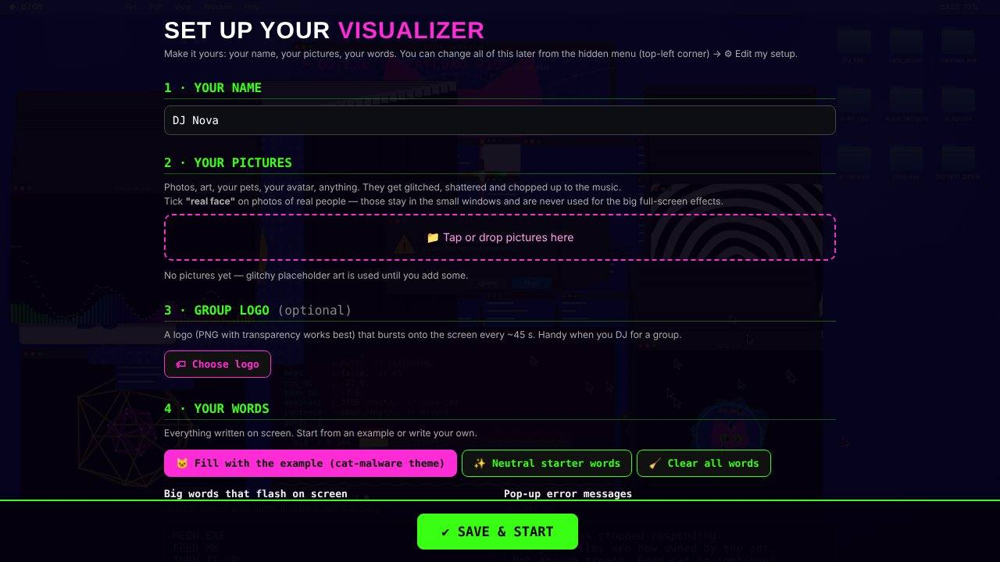
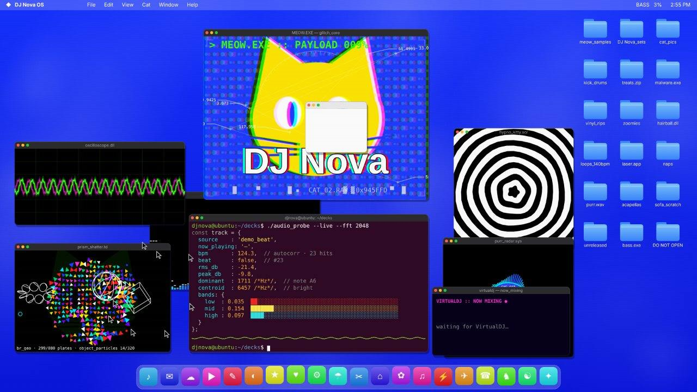
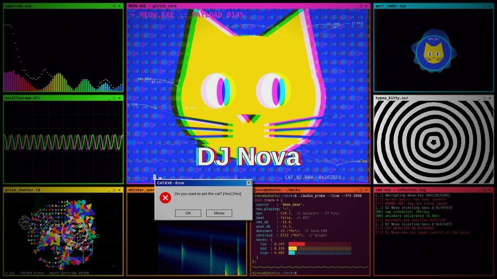
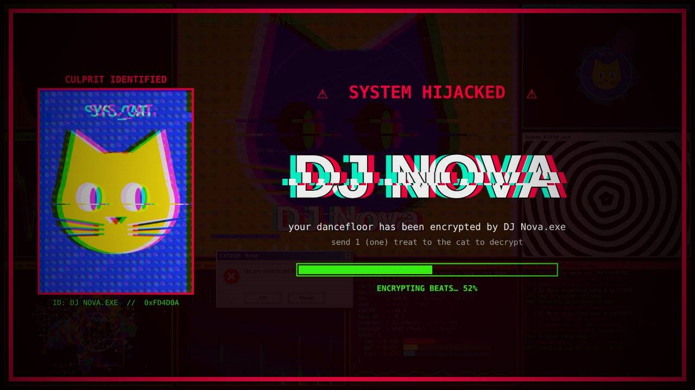

# 🐱💻 Glitch Visualizer

**A glitch-malware audio visualizer for DJ streams. Your name, your pictures, your words.**
Originally made by **DJMackilla** for Twitch & VRChat sets.

Fake desktop windows explode on the beat, pictures get glitched and shattered into prisms, a kaleidoscope tunnel spins with the bass, pop-up "errors" spam the screen, and every so often the whole system gets *hijacked* by your name.



| Desktop scene | Wall scene | Takeover |
|---|---|---|
|  |  |  |

---

## ⬇️ Get it

Go to **[Releases](../../releases/latest)** and download the one for your computer:

| Your computer | Download | Then |
|---|---|---|
| **Windows** (easiest) | `Glitch-Visualizer-Setup.exe` | Double-click → it installs and opens. Shortcuts land on your desktop and Start menu. |
| Windows, no install | `Glitch-Visualizer.exe` | Double-click to run. Good for a USB stick. |
| **Mac** (Apple Silicon & Intel) | `Glitch-Visualizer-Mac.zip` | Unzip → drag **Glitch Visualizer** into **Applications** → **right-click it → Open → Open** (first time only). |
| Anything else / phone | `index.html` (or the web link on this page) | Open it in a browser. |

> **Windows says "Windows protected your PC"?** The app isn't code-signed (that costs money). Click **More info → Run anyway**.
> **Mac says it "can't be opened"?** Open **System Settings → Privacy & Security**, scroll down, click **Open Anyway**. If it says the app is *damaged*, open Terminal and run `xattr -cr "/Applications/Glitch Visualizer.app"`.

## 🎛️ Make it yours (first launch)

The first time you open it, a **setup screen** asks for:

1. **Your name** — shows up in the big glitch text, the takeover screen, the fake OS, the terminals.
2. **Your pictures** — photos, art, pets, your avatar. Tick **"real face"** on photos of real people: they stay in small windows and are never used for the big full-screen effects.
3. **Group logo** *(optional)* — bursts onto the screen every ~45 s. Great when you DJ for a group.
4. **Your words** — the big flashing words (*ZOOMIES*, *MORE BASS*…), pop-up error messages, hacker terminal lines, desktop folder names, window names, the takeover screen text. Hit **"Fill with the example"** to start from the cat-malware theme, or write your own.

Then press **SAVE & START** and **play some music**. That's it.

Change anything later: move the mouse to the **top-left corner** → **+** → **⚙ Edit my setup**.

### Share a theme
In the setup screen: **📤 Save theme file** makes one `.json` with everything (pictures included). Send it to a friend → they hit **📥 Load theme file**. Example: [`themes/cat-malware-example.json`](themes/cat-malware-example.json).

Special words you can use in any text: `{name}` your name · `{NAME}` in capitals · `{user}` lowercase username · `{hex}` random hex code · `{n}` random 0–99 · `{lives}` random 1–9 · `{mm}` random decimal.

## 🎧 How it hears the music

**Windows app:** nothing to set up — it automatically listens to **music apps only**: Spotify, YouTube / SoundCloud / Bandcamp in a browser tab, VirtualDJ, rekordbox, Serato, Traktor, Mixxx, djay, Apple Music, TIDAL, Deezer, Amazon Music, foobar2000, Winamp, MusicBee, VLC, Windows Media Player.
It **never** uses your microphone and **never** hears Discord, VRChat, Zoom, Teams, OBS or games (hard-blocked). Missing your app? Add it to `SOURCES` in [`app/main.js`](app/main.js).

**Mac app:** play your music, then open the menu (top-left corner) → **🔊 Capture system audio** (macOS 13 or newer; allow *Screen & System Audio Recording* when asked), or **🎤 Use audio input** for a mic or DJ controller.

**Browser:** open the menu (top-left corner) and choose 🔊 computer sound (Chrome: pick a tab/screen and tick *Share audio*), 🎤 microphone, or 🎵 an audio file. On phones: play music out loud and tap the screen to the beat.

**VirtualDJ users:** the track you're mixing shows up in the *now mixing* window. For faster updates, set `historyDelay` to 10 in VirtualDJ's options.

## 📺 OBS setup

1. Open the Glitch Visualizer app.
2. OBS → **Sources → + → Window Capture** → Window: **Glitch Visualizer** → on Windows set Capture Method: **Windows 10 (1903 and up)** → untick **Capture Cursor**.
3. Right-click the source → **Transform → Fit to screen**.

Keep the app open (it can sit behind OBS — it keeps drawing). Press **F11** in the app for fullscreen.

Prefer a Browser Source? While the Windows app runs, add a **Browser Source** with URL `http://localhost:17777/?app=1&hideui=1`, 1920×1080.

## ⌨️ Keys

| Key | Does |
|---|---|
| `1` / `2` / `0` | desktop scene / wall scene / auto-switch |
| `M` | takeover now |
| `L` | show group logo now |
| `P` | pop-up |
| `Space` | next picture |
| `H` | hide the menu button completely |
| `F` / `F11` | fullscreen |

## 🛠️ Build it yourself

```bash
cd app
npm install
npm start          # run it
npm run dist       # Windows: app/dist/Glitch-Visualizer-Setup.exe + Glitch-Visualizer.exe
npm run dist-mac   # Mac: app/dist/mac-universal/Glitch Visualizer.app
```

Or let GitHub build them for you: **publish a Release** (or **Actions → Build apps → Run workflow**) and the Windows installer, the portable `.exe` and the Mac `.zip` are built and attached automatically. Free web link: **Settings → Pages → Source: GitHub Actions** — every push to `main` publishes `index.html`.

Everything is one file: [`index.html`](index.html) (the visualizer + setup screen). The Windows app ([`app/`](app)) wraps the same page and adds per-app audio capture.

## 📄 License

MIT — use it, remix it, stream with it. A shout-out to **DJMackilla** is appreciated 💜
